# T3 Themes

Seven space themes for [T3 Code](https://t3.codes). Each one puts a single large piece of artwork behind the app, restyles the panels to match, and moves a little: slowly at rest, and a bit more while an agent is working.

Every theme is checked on two screens: the empty start screen, and a thread with a conversation in it.

| Theme | Start screen | In a thread |
| --- | --- | --- |
| **Sidereal**<br>The real summer Milky Way from Scorpius to Cygnus, as dithered pixels behind glass. | 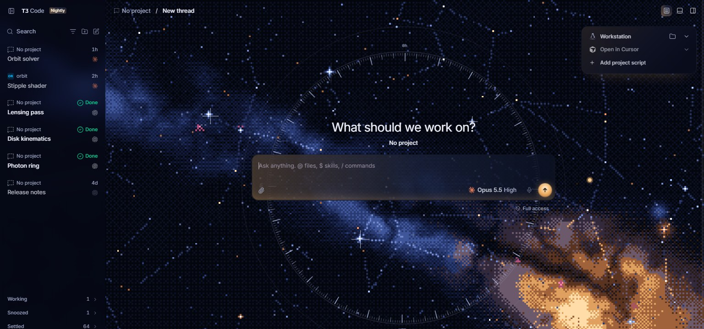 | 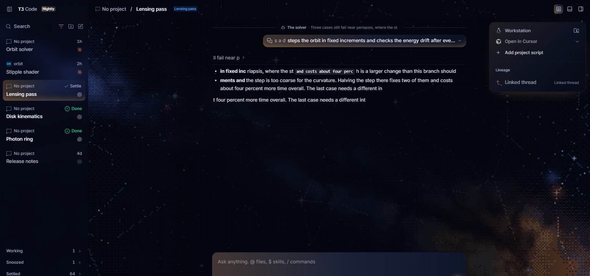 |
| **Event Horizon**<br>A black hole in stipple grain. The grain orbits it. | 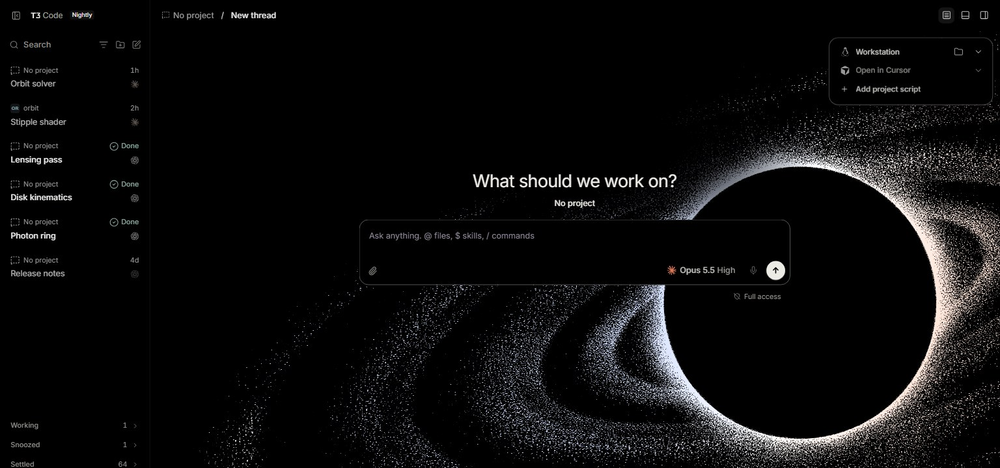 | 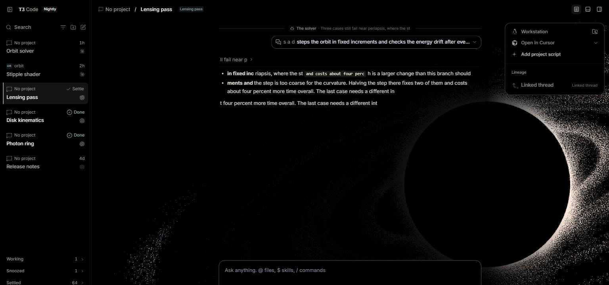 |
| **First Magnitude**<br>One blinding star on an old glass-plate photograph. | 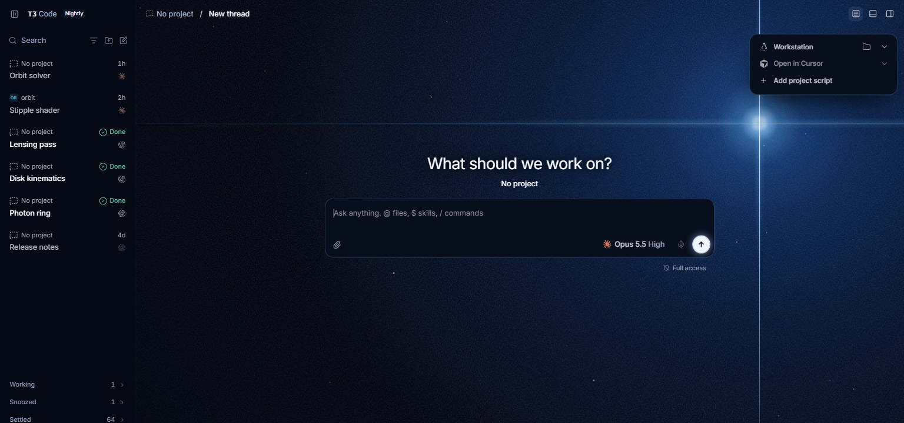 | 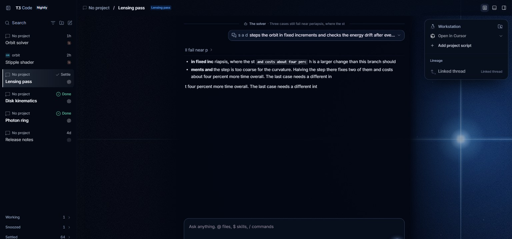 |
| **Terminator**<br>A lunar horizon in coarse photocopy halftone. | 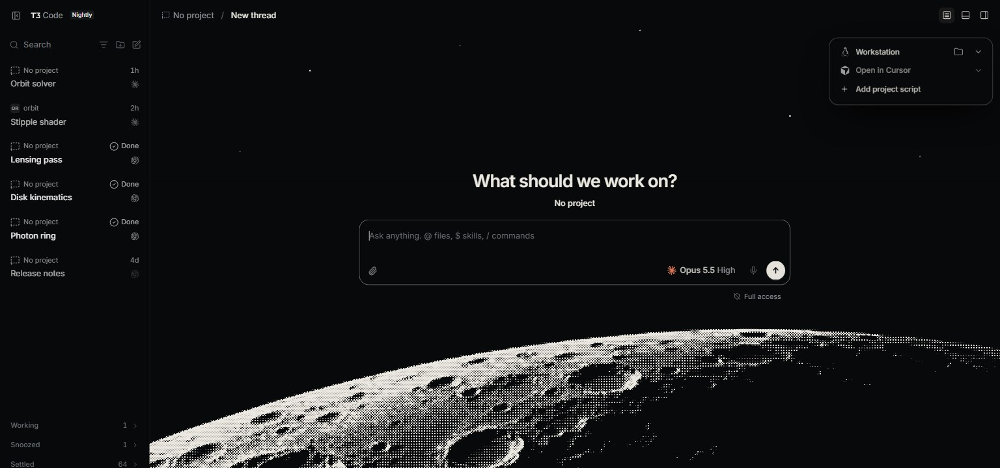 | 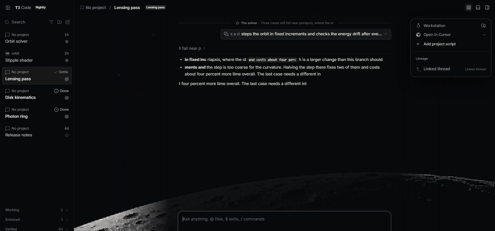 |
| **Perihelion**<br>A great comet in a woodblock-print style. | 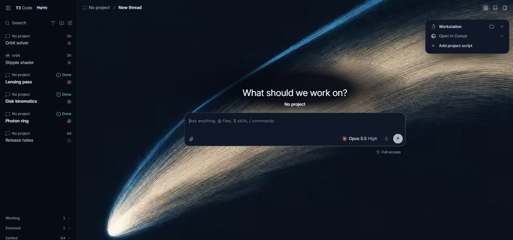 | 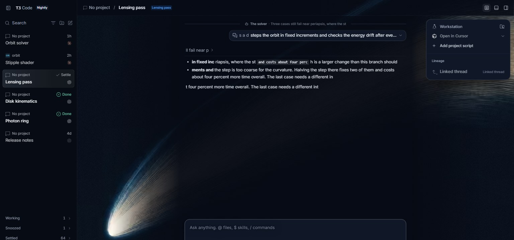 |
| **Helix**<br>A planetary nebula as a two-ink silkscreen. | 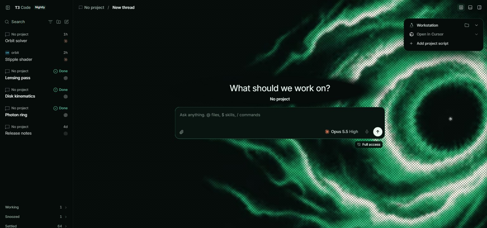 | 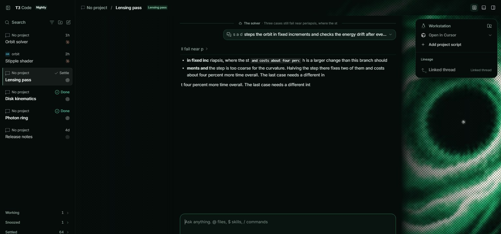 |
| **Grand Tour Night**<br>A ringed planet as a dark risograph travel poster, with a rocket. | 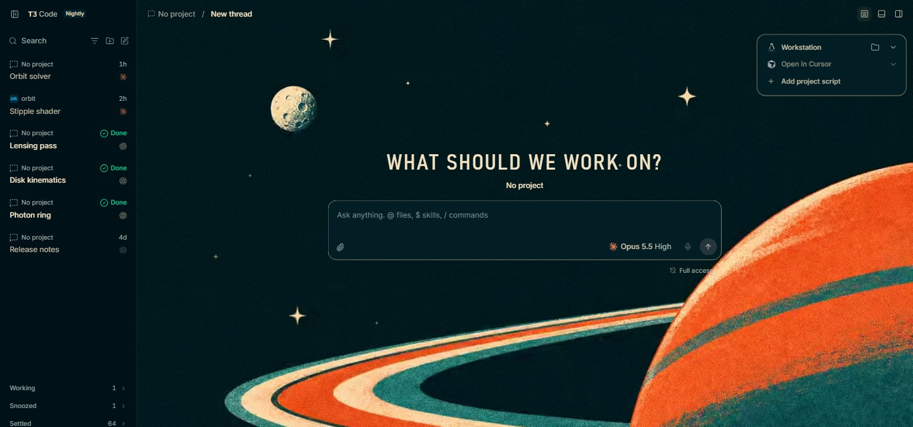 | 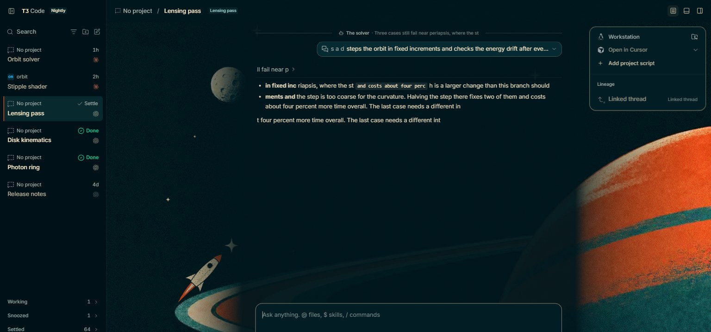 |

## Install

Each theme is one file, `<theme>/<theme>.json`. Install as many as you like and switch between them in Settings › Appearance.

```sh
curl -fsSL https://raw.githubusercontent.com/Winds-AI/agent-tools/main/t3-themes/event-horizon/event-horizon.json -o event-horizon.json
t3 theme set event-horizon.json
```

The theme ids are `sidereal`, `event-horizon`, `first-magnitude`, `terminator`, `perihelion`, `helix` and `grand-tour-night`. T3 switches as soon as a theme is set. To go back, pick another theme in the theme picker or run `t3 theme set t3-chat`.

### Let your agent install one

Paste this into a T3 Code thread, with the theme you want:

> Install the Event Horizon theme from https://github.com/Winds-AI/agent-tools/tree/main/t3-themes. Follow the "Instructions for agents" section of its README.

### Instructions for agents

1. Download the chosen theme's file: `https://raw.githubusercontent.com/Winds-AI/agent-tools/main/t3-themes/<id>/<id>.json`.
2. If the `t3` command is available, run `t3 theme set <path to the file>`. Otherwise call the `t3_theme_set` tool with `themeId` set to the theme's id and the file's JSON as `theme`.
3. Do not edit the file. Most of these themes are within a few hundred characters of the size limit T3 allows.

## What moves

| Theme | At rest | While an agent works |
| --- | --- | --- |
| Sidereal | The brightest stars shimmer, a meteor crosses now and then, and a setting circle turns on the start screen. | A point of light orbits the composer. |
| Event Horizon | Six layers of grain orbit the hole, the inner ones faster. | The bright ring flares and breathes. |
| First Magnitude | The star's bloom and spikes breathe. | The star brightens and its spikes reach further. |
| Terminator | The Moon drifts beneath a still dot screen. | Light breathes over the sunlit limb. |
| Perihelion | A band of light travels up the tail. | The comet's head glows. |
| Helix | The nebula breathes and its central star twinkles. | The inner shell glows. |
| Grand Tour Night | The rocket rides the ring and the stars twinkle in stop-motion. | The rocket gets a long flame and a dashed trail. |

All motion stops when the system asks for reduced motion.

## Requirements and notes

- A recent T3 Code Nightly (November 2026 or later), in the desktop app or the browser. The phone app does not use themes.
- All seven are dark only.
- The background motion advances in small steps a few times a second instead of on every frame, so the GPU has little to redraw. The steps are smaller than a pixel.
- If a future T3 update changes its layout, a few touches may fall back to T3's normal look. Nothing breaks.

## How they are made

A T3 theme holds colour roles and at most 20,000 characters of CSS, pictures included.

- **Sidereal** draws its sky from a real star catalogue (`sidereal/art.py`) and stores it as a small dithered bitmap.
- **Event Horizon** and **First Magnitude** are drawn entirely with CSS gradients and SVG noise.
- **Terminator**, **Perihelion**, **Helix** and **Grand Tour Night** each carry a painting from `art/`, compressed to about 10 KB of AVIF, with print texture and motion layered on top. Terminator's halftone dots are printed live over the picture so they stay crisp.

To rebuild a theme:

```sh
python3 -m venv .venv
.venv/bin/pip install -r requirements.txt
cd event-horizon
../.venv/bin/python build.py
```

`build.py` writes `<theme>.json` next to itself and a preview stylesheet under `/tmp/t3-themes/`. `kit/kit.py` holds the shared helpers: the minifier, `data:` encoders for SVG, WebP and AVIF, and the stepped easing. `kit/page-helpers.js` is for trying a theme in a browser tab on a running T3 without installing it.

## Credits

- The CSS structure of Sidereal and the minifier in `kit/kit.py` follow [Nyx](https://github.com/Deepusleepy/t3-nyx-theme) by Deepusleepy (MIT). Nyx set the bar these themes were built to.
- Sidereal's star positions, constellation figures and Milky Way outline come from [d3-celestial](https://github.com/ofrohn/d3-celestial) by Olaf Frohn (BSD-3-Clause). The three data files in `sidereal/data/` are copied from it unchanged.
- The paintings in `art/` were generated with `gpt-image-2` through [Codex Image](../codex-image).

## License

MIT
